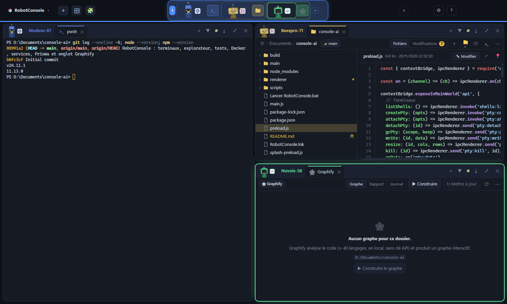
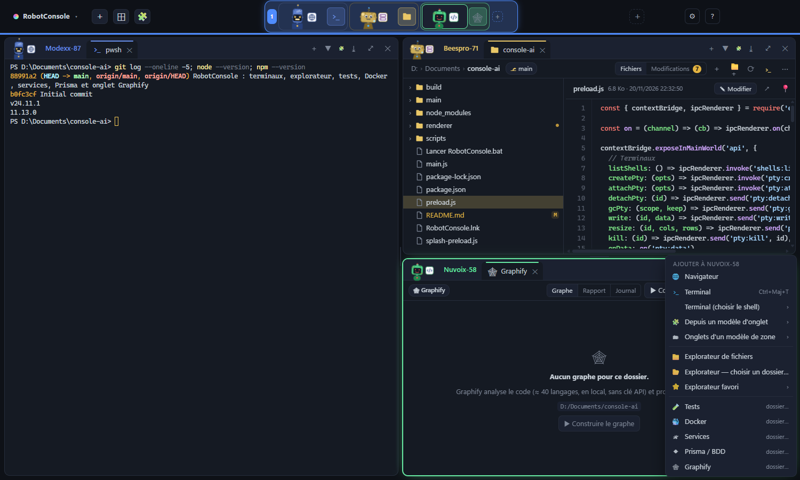

# RobotConsole

Un outil pour arrêter de se perdre dans ses consoles ouvertes.

RobotConsole réunit dans une seule fenêtre vos terminaux, un explorateur de fichiers avec Git, vos tests, vos conteneurs Docker, vos services, votre base de données et le graphe de votre code. Chaque **espace** de travail a son petit **robot** : on le reconnaît d'un coup d'œil, il réagit à ce qui se passe et il range ses onglets quand on n'en a plus besoin.



## Fonctionnalités

### Des espaces, des robots, des écrans
- **Espaces** : chaque zone de la fenêtre regroupe des onglets et porte un robot généré (nom, couleurs, accessoires). Le robot s'anime quand un terminal écrit, signale les onglets non lus et peut changer d'apparence selon l'onglet actif.
- **Disposition libre** : découpez la fenêtre en colonnes et en lignes, redimensionnez, agrandissez un espace (`Ctrl+Maj+M`), glissez des onglets d'un espace à l'autre.
- **Barre des robots** : tous les espaces sont visibles en haut ; on peut « ranger » un robot pour libérer de la place, puis le ressortir d'un clic.
- **Écrans** : plusieurs jeux d'espaces dans la même fenêtre, comme des bureaux virtuels (`Ctrl+Alt+1…9`, `Ctrl+Alt+←/→`).
- **Plusieurs fenêtres** : un espace peut être détaché dans une autre fenêtre puis ramené par glisser-déposer.
- **Session restaurée** : disposition, onglets et terminaux sont retrouvés au redémarrage (les terminaux tournent dans un processus séparé et survivent à un rechargement).

### Les types d'onglets

| Onglet | Ce qu'il fait |
| --- | --- |
| **>_ Terminal** | xterm.js + node-pty : PowerShell 7, Windows PowerShell, cmd, Git Bash, WSL… Recherche, liens cliquables, rendu WebGL, commandes de démarrage. |
| **📁 Explorateur** | Arbre de fichiers avec aperçu (code coloré, Markdown, images), état Git, diff, indexation / annulation de fichiers, favoris, ouverture dans l'éditeur intégré (Monaco). |
| **🧪 Tests** | Découvre les suites du projet, les classe (unitaires, règles métier, intégration, end-to-end…), les lance, affiche les échecs et la sortie, mode surveillance. |
| **🐳 Docker** | Conteneurs regroupés par fichier compose : état, santé, ports, CPU, mémoire, actions et journaux en direct. |
| **🛰 Services** | Services du workspace (`.robot/services.json`) : démarrage / arrêt, ports détectés, santé HTTP, redémarrage automatique, journaux interactifs. |
| **◆ Prisma / BDD** | Schéma Prisma, diagramme des tables, navigation dans les données, console SQL (PostgreSQL), migrations. |
| **🕸 Graphify** | Construit et affiche le graphe de connaissances du projet avec [Graphify](https://github.com/Graphify-Labs/graphify) : graphe interactif, rapport, journal. |
| **🌐 Navigateur** | Un navigateur web isolé, pratique pour garder `http://localhost:3000` à côté de son terminal. |




### Workspaces et modèles
- **Workspace** : ouvrez un dossier comme workspace (`Ctrl+O`). Sa configuration est rangée dans `.robot/` (nom, robot, modèles, favoris, services), à versionner pour la partager avec l'équipe. La disposition locale reste dans `.robot/state.json`, ignoré par Git.
- **Modèles** d'onglet, de zone et d'écran : enregistrez « un terminal dans `apps/api` qui lance `npm run dev` », un espace complet ou un écran entier, puis rouvrez-le en un clic.

### Personnalisation
- Thèmes : Minuit, Aube (clair), Océan, Forêt, Néon et Contraste élevé. Chaque thème règle aussi la palette des terminaux et la coloration syntaxique.
- Atelier du robot : apparence, couleurs, accessoires et icône d'outil de chaque robot.
- Police, taille, shell par défaut, comportement de l'éditeur, écran de démarrage…


## Installation

Prérequis : **Windows 10/11**, [Node.js](https://nodejs.org) 20 ou plus récent et Git. L'application fonctionne aussi sous macOS et Linux, mais elle est développée et testée sous Windows.

```bash
git clone https://github.com/simonbonjean-bot/RobotConsole.git
cd RobotConsole
npm install
npm start
```

Sous Windows, `Lancer RobotConsole.bat` démarre l'application (après `npm install`).

### Graphify (facultatif)
L'onglet Graphify utilise le CLI Python `graphify` (Python 3.11+) :

```bash
uv tool install graphifyy     # ou : pipx install graphifyy
```

Le bouton **Construire** lance `graphify extract . --code-only`, qui analyse le code localement, sans modèle ni clé API. Le résultat est écrit dans `graphify-out/` (`graph.html`, `graph.json`, `GRAPH_REPORT.md`), et l'onglet se met à jour tout seul quand ce dossier change.

## Raccourcis clavier

| Raccourci | Action |
| --- | --- |
| `Ctrl+Maj+N` | Nouvel espace |
| `Ctrl+Maj+T` | Nouveau terminal dans l'espace actif |
| `Ctrl+Maj+E` | Explorateur de fichiers |
| `Ctrl+Maj+W` | Fermer l'onglet |
| `Ctrl+Maj+M` | Agrandir / restaurer l'espace |
| `Ctrl+Maj+L` | Choisir une disposition |
| `Ctrl+Tab` / `Ctrl+Maj+Tab` | Onglet suivant / précédent |
| `Alt+1…9`, `Alt+←/→` | Aller à un espace |
| `Ctrl+Alt+1…9`, `Ctrl+Alt+←/→` | Changer d'écran |
| `Ctrl+O` | Ouvrir un workspace |
| `Ctrl+,` | Réglages |

## Structure du projet

```
main.js            processus principal Electron (fenêtres, IPC)
preload.js         API exposée à l'interface (contextIsolation)
main/              terminaux (ptyhost), fichiers et Git, tests, Docker, services, Prisma, Graphify, workspaces
renderer/          interface : app.js (espaces, disposition, robots) et un fichier par type d'onglet
scripts/           génération des icônes et des emojis
build/             icônes de l'application
```

Les données de l'application (état, réglages) sont dans `%APPDATA%\RobotConsole`. Pour lancer une instance avec un autre profil, utilisez la variable d'environnement `ROBOTCONSOLE_USERDATA`.
