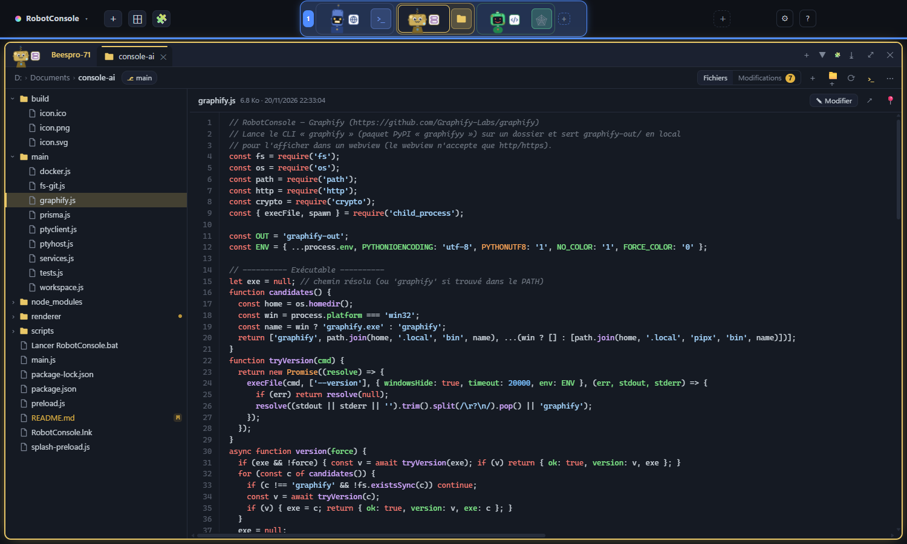
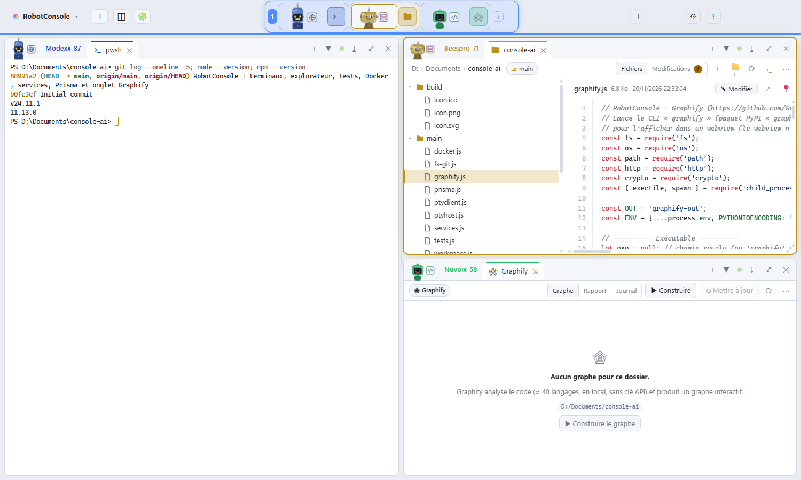

# RobotConsole

*English · [Français](README.fr.md)*

A tool to stop getting lost among your open consoles.

RobotConsole brings your terminals, a file explorer with Git, your tests, your Docker containers, your services, your database and your code graph together in a single window. Each work **space** has its own little **robot**: you recognize it at a glance, it reacts to what's happening, and it tidies away its tabs when you no longer need them.


## Features

### Spaces, robots, screens
- **Spaces**: each area of the window groups tabs and carries a generated robot (name, colors, accessories). The robot animates when a terminal writes, flags unread tabs and can change its look depending on the active tab.
- **Free layout**: split the window into columns and rows, resize, maximize a space (`Ctrl+Shift+M`), drag tabs from one space to another.
- **Robot bar**: every space is visible at the top; you can "park" a robot to free up room, then bring it back with a click. A whole screen can be folded into small squares.
- **Screens**: several sets of spaces in the same window, like virtual desktops (`Ctrl+Alt+1…9`, `Ctrl+Alt+←/→`).
- **Multiple windows**: a space can be detached into another window, then brought back by drag and drop.
- **Session restore**: layout, tabs and terminals come back after a restart (terminals run in a separate process and survive a reload).

### Tab types

| Tab | What it does |
| --- | --- |
| **>_ Terminal** | xterm.js + node-pty: PowerShell 7, Windows PowerShell, cmd, Git Bash, WSL… Search, clickable links, WebGL rendering, startup commands. |
| **📁 Explorer** | File tree with preview (highlighted code, Markdown, images), Git status, diff, staging / discarding files, favorites, opening in the built-in editor (Monaco). |
| **🧪 Tests** | Discovers the project's suites, sorts them (unit, business rules, integration, end-to-end…), runs them, shows failures and output, watch mode. |
| **🐳 Docker** | Containers grouped by compose file: status, health, ports, CPU, memory, actions and live logs. |
| **🛰 Services** | Workspace services (`.robot/services.json`): start / stop, detected ports, HTTP health checks, automatic restart, interactive logs. |
| **◆ Prisma / DB** | Prisma schema, table diagram, data browsing, SQL console (PostgreSQL), migrations. |
| **🕸 Graphify** | Builds and displays the project's knowledge graph with [Graphify](https://github.com/Graphify-Labs/graphify): interactive graph, report, log. |
| **🌐 Browser** | An isolated web browser, handy for keeping `http://localhost:3000` next to your terminal. |




### Workspaces and templates
- **Workspace**: open a folder as a workspace (`Ctrl+O`). Its configuration lives in `.robot/` (name, robot, templates, favorites, services) and can be committed to share it with your team. The local layout stays in `.robot/state.json`, which Git ignores.
- **Templates** for tabs, zones and screens: save "a terminal in `apps/api` that runs `npm run dev`", a complete space or a whole screen, then reopen it in one click.

### Customization
- Themes: Midnight, Dawn (light), Ocean, Forest, Neon and High contrast. Each theme also sets the terminal palette and syntax highlighting.
- Robot workshop: look, colors, accessories, body parts (arms, locomotion, gear…) and tool icon of each robot. Each trait can be animated or not.
- Font, size, default shell, editor behavior, start screen…
- **Language**: English or French (Settings → Appearance → Language), or automatic based on the system language. The change applies immediately.



*Screenshots show the interface in French.*

## Installation

Requirements: **Windows 10/11**, [Node.js](https://nodejs.org) 20 or newer, and Git. The app also runs on macOS and Linux, but it is developed and tested on Windows.

```bash
git clone https://github.com/simonbonjean-bot/RobotConsole.git
cd RobotConsole
npm install
npm start
```

On Windows, `Lancer RobotConsole.bat` starts the app (after `npm install`).

### Graphify (optional)
The Graphify tab uses the `graphify` Python CLI (Python 3.11+):

```bash
uv tool install graphifyy     # or: pipx install graphifyy
```

The **Build** button runs `graphify extract . --code-only`, which analyzes the code locally, with no model or API key. The result is written to `graphify-out/` (`graph.html`, `graph.json`, `GRAPH_REPORT.md`), and the tab refreshes on its own when that folder changes.

## Keyboard shortcuts

| Shortcut | Action |
| --- | --- |
| `Ctrl+Shift+N` | New space |
| `Ctrl+Shift+T` | New terminal in the active space |
| `Ctrl+Shift+E` | File explorer |
| `Ctrl+Shift+W` | Close the tab |
| `Ctrl+Shift+M` | Maximize / restore the space |
| `Ctrl+Shift+L` | Choose a layout |
| `Ctrl+Tab` / `Ctrl+Shift+Tab` | Next / previous tab |
| `Alt+1…9`, `Alt+←/→` | Go to a space |
| `Ctrl+Alt+1…9`, `Ctrl+Alt+←/→` | Switch screen |
| `Ctrl+O` | Open a workspace |
| `Ctrl+,` | Settings |
| `Shift+Enter` (terminal) | New line without submitting (Claude Code and other interactive CLIs) |

## Project structure

```
main.js            Electron main process (windows, IPC)
preload.js         API exposed to the interface (contextIsolation)
main/              terminals (ptyhost), files and Git, tests, Docker, services, Prisma, Graphify, workspaces, i18n
renderer/          interface: app.js (spaces, layout, robots) and one file per tab type
                   i18n.js + i18n-en.js: interface translation (French → English dictionary)
scripts/           icon and emoji generation
build/             application icons
```

The app's data (state, settings) lives in `%APPDATA%\RobotConsole`. To run an instance with a separate profile, set the `ROBOTCONSOLE_USERDATA` environment variable.

### Translations
The interface source text is French. `renderer/i18n.js` translates what is displayed (texts, tooltips, placeholders) using the dictionary in `renderer/i18n-en.js`, where each French text maps to its English translation and `{0}`, `{1}`… mark variable parts. User content (terminals, editor, file previews, SQL data, logs) is never translated. To translate a new text, add its French version and translation to `i18n-en.js`; in code that writes outside the DOM (terminal messages, native dialogs), use `I18n.t('Texte {0}', value)`.
