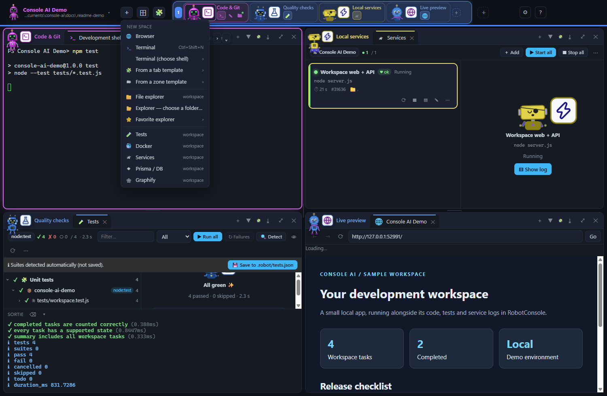
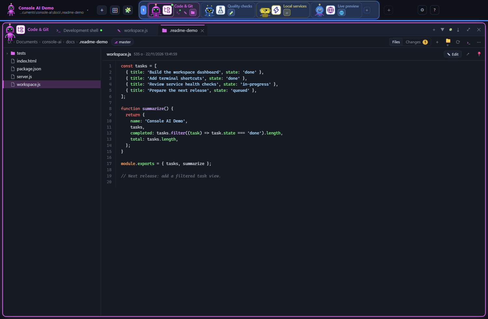
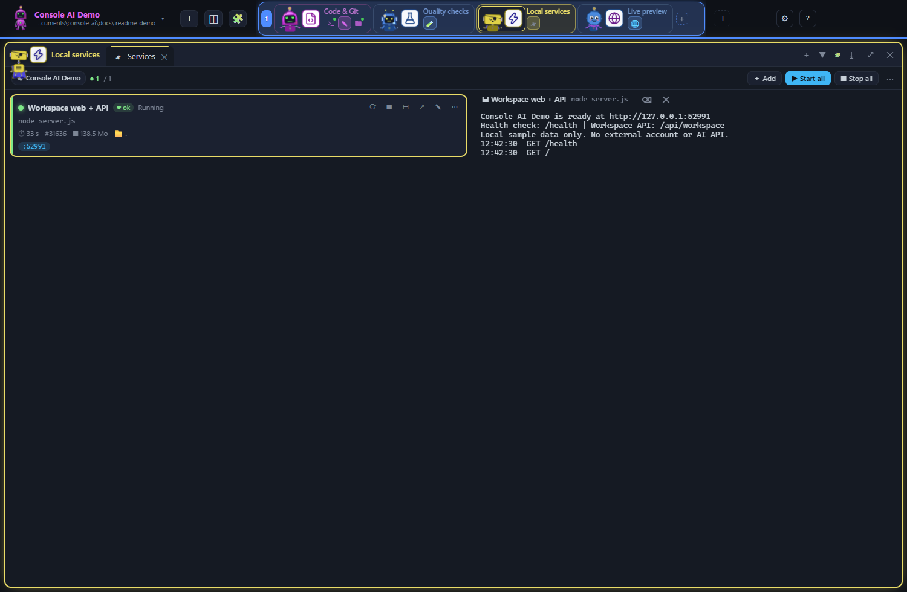
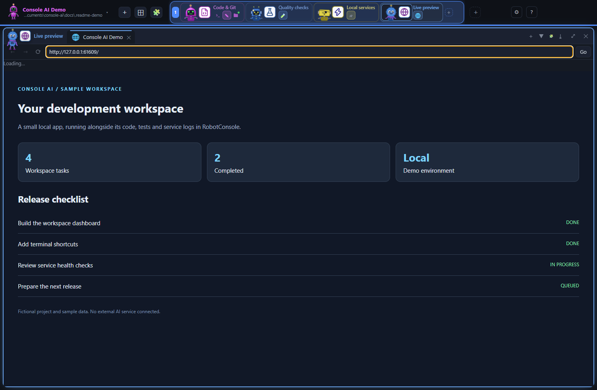

# RobotConsole

A tool to stop getting lost among your open consoles.

RobotConsole brings your terminals, a file explorer with Git, your tests, your Docker containers, your services, your database and your code graph together in a single window. Each work **space** has its own little **robot**: you recognize it at a glance, it reacts to what's happening, and it tidies away its tabs when you no longer need them.


*Real screenshots of RobotConsole in English, using a fictional "Console AI Demo" project: a local Node.js app, sample tasks, Git changes and actual test runs. No external AI service or personal data is used.*

## Features

### Spaces, robots, screens
- **Spaces**: each area of the window groups tabs and carries a generated robot (name, colors, accessories). The robot animates when a terminal writes, flags unread tabs and can change its look depending on the active tab.
- **Free layout**: split the window into columns and rows, resize, maximize a space (`Ctrl+Shift+M`), drag tabs from one space to another.
- **Robot bar**: every space is visible at the top; you can "park" a robot to free up room while its terminals keep running, then bring it back with a click. Double-click a robot in the bar to put it to sleep: it shrinks and its tabs are summed up by a single badge, including unread/error indicators. Use the badge to choose a tab, or click the robot to wake it. A whole screen can be folded into small squares.
- **Drag-and-drop organization**: reorder tabs, send them to another robot or screen, or drop a tab into an empty part of the robot bar to create a new space.
- **Screens**: several sets of spaces in the same window, like virtual desktops (`Ctrl+Alt+1…9`, `Ctrl+Alt+←/→`).
- **Multiple windows**: a space can be detached into another window, then brought back by drag and drop.
- **Session restore**: layout, tabs and terminals come back after a restart (terminals run in a separate process and survive a reload).

### Tab types

| Tab | What it does |
| --- | --- |
| **>_ Terminal** | xterm.js + node-pty: PowerShell 7, Windows PowerShell, cmd, Git Bash, WSL… Search, clickable links, WebGL rendering, startup commands. |
| **📁 Explorer / editor** | File tree, code / Markdown / image previews, Git status and diffs, staging / discarding, favorites and file operations. Built-in Monaco editor with find / replace, multiple cursors, undo / redo, display options and a clickable status bar. |
| **🧪 Tests** | Discovers suites and groups them by category (unit, business rules, integration, end-to-end…). Supports Vitest, Jest, Playwright, node:test, pytest, Go, Cargo and custom commands. Run all suites or retry failures, inspect output, filter results and enable watch mode. |
| **🐳 Docker** | Containers grouped by compose file: status, health, ports, CPU, memory, actions and live logs. |
| **🛰 Services** | Workspace services (`.robot/services.json`): start / stop, detected ports, HTTP health checks, automatic restart, interactive logs. |
| **◆ Prisma / DB** | Prisma schema, table diagram, data browsing, SQL console (PostgreSQL), migrations. |
| **🕸 Graphify** | Builds and displays the project's knowledge graph with [Graphify](https://github.com/Graphify-Labs/graphify): interactive graph, report, log. |
| **🌐 Browser** | An isolated web browser, handy for keeping `http://localhost:3000` next to your terminal. |



### Files, Git and code editing
- Browse files, preview code, Markdown and images, inspect Git changes and stage or discard individual files. Create, rename, copy, move, duplicate or send files to the recycle bin.
- Open a file in Monaco with double-click or `Enter`. `Ctrl+F` / `Ctrl+H` in an editable text preview opens the editor with find / replace; those shortcuts and `Ctrl+G` also work from the editor's surrounding controls.
- Use rectangular selection, multiple cursors, line operations, comments, word wrap, minimap, sticky scroll and zoom. The status bar exposes line/column, indentation, encoding, line endings and language.
- Undo / redo is retained when a file is closed and reopened within the same app session. External changes reload clean files; unsaved edits trigger a warning with a choice to reload from disk or keep your version. The editor also warns if a file disappears, and its path can be changed to open another file.




### Tests, services and live preview
Keep checks and runtime tools next to the code rather than switching between unrelated windows.


Workspace services show their status, detected ports and HTTP health checks, with start / stop / restart actions and interactive logs. Copy selected text with `Ctrl+C` / `Ctrl+Shift+C` or the context menu in the test, Docker and service consoles; interactive consoles also support paste.



The browser tab keeps a local web app inside your workspace, with its own address bar and navigation controls.



### Workspaces and templates
- **Workspace**: open a folder as a workspace (`Ctrl+O`). Its configuration lives in `.robot/` (name, robot, templates, favorites, services) and can be committed to share it with your team. The local layout stays in `.robot/state.json`, which Git ignores.
- **Templates** for tabs, zones and screens: save "a terminal in `apps/api` that runs `npm run dev`", a complete space or a whole screen, then reopen it in one click.

For example, keep a development screen with the editor and terminal, a quality-check screen with tests, and an operations screen with services, Docker or a database. Templates let you reuse the setup without rebuilding the layout.

### Remote access (phone, tablet)
- Open some robots to another device: click a robot → **📡 Sharing** → *Read-only* or *Control*. The panel shows a QR code that opens that robot directly on the phone (with the robot as the tab icon). The 📡 badge shows which robots are open. The end-of-work sound is set in the same panel (🔔).
- Enable the server in **Settings → Remote access** and scan the QR code with your phone (same Wi-Fi, or through a VPN such as Tailscale). Only open robots are visible.
- Terminals are live (with a key bar for Esc, Tab, Ctrl, arrows in control mode). The other tabs have a mobile view: start/stop services, run tests, Docker up/stop/restart, browse files and Git diffs, browse database tables, take a screenshot of a browser tab…
- The link carries a secret token (kept in a cookie, regenerable). Do not expose the port to the Internet.
- **From any network**: link the PC to a separately deployed, self-hosted `robotconsole-relay` (Settings → Remote access → Relay → Sign in). Phones sign in to the same account; everything is end-to-end encrypted and each new phone is approved on the PC with a 6-digit code. The relay is not included in this repository.

### Customization
- Themes: Midnight, Dawn (light), Ocean, Forest, Neon and High contrast. Each theme also sets the terminal palette and syntax highlighting.
- Robot workshop: look, colors, accessories, body parts (arms, locomotion, gear…) and tool icon of each robot. Each trait can be animated or not.
- **Robot bar styles**: Classic, Compact, Dock, Labels and Minimal, with previews in Settings. Choose between visible tabs, larger robots, space names or a slimmer bar.
- **Activity animations**: choose hammer taps, bounce, shake, pulse, swing or no animation for the "Working on" icon. It moves only while the space has activity; the tool can automatically match the current tab.
- Show or hide the robot's body in the space header, toggle animations and speech bubbles, and adjust completion-sound volume.
- Font, size, default shell, editor behavior, start screen…
- **Language**: English or French (Settings → Appearance → Language), or automatic based on the system language. The change applies immediately.


## Installation

Requirements: **Windows 10/11**, [Node.js](https://nodejs.org) 20 or newer, and Git. The app also runs on macOS and Linux, but it is developed and tested on Windows.

```bash
git clone https://github.com/simonbonjean-bot/RobotConsole.git
cd RobotConsole
npm install
npm start
```

On Windows, `Lancer RobotConsole.bat` starts the app (after `npm install`).

### Optional tool requirements
The core terminal, explorer/editor and browser do not require Docker or a database. Tests use the selected project's own runner; services use the commands configured in `.robot/services.json`.

- **Docker tab**: Docker CLI and a running Docker engine; Compose projects use Docker Compose.
- **Prisma / DB tab**: a project's Prisma schema for the diagram, and a reachable PostgreSQL database for queries and data browsing.
- **Remote access**: enable the local server explicitly; access from other networks requires your own relay deployment or an appropriate private network.

### Graphify (optional)
The Graphify tab uses the `graphify` Python CLI (Python 3.11+):

```bash
uv tool install graphifyy     # or: pipx install graphifyy
```

The **Build** button runs `graphify extract . --code-only`, which analyzes the code locally, with no model or API key. The result is written to `graphify-out/` (`graph.html`, `graph.json`, `GRAPH_REPORT.md`), and the tab refreshes on its own when that folder changes.

## Keyboard shortcuts

| Shortcut | Action |
| --- | --- |
| `Ctrl+Shift+N` | New space |
| `Ctrl+Shift+T` | New terminal in the active space |
| `Ctrl+Shift+E` | File explorer |
| `Ctrl+Shift+W` | Close the tab |
| `Ctrl+Shift+M` | Maximize / restore the space |
| `Ctrl+Shift+L` | Choose a layout |
| `Ctrl+Tab` / `Ctrl+Shift+Tab` | Next / previous tab |
| `Alt+1…9`, `Alt+←/→` | Go to a space |
| `Ctrl+Alt+1…9`, `Ctrl+Alt+←/→` | Switch screen |
| `Ctrl+O` | Open a workspace |
| `Ctrl+,` | Settings |
| `Shift+Enter` (terminal) | New line without submitting (Claude Code and other interactive CLIs) |
| `Ctrl+F` / `Ctrl+H` (editor or editable preview) | Find / replace |
| `Ctrl+G` (editor) | Go to line |
| `Ctrl+S` (editor) | Save |
| `Ctrl+Z` / `Ctrl+Y` (editor) | Undo / redo |

## Project structure

```
main.js            Electron main process (windows, IPC)
preload.js         API exposed to the interface (contextIsolation)
main/              terminals (ptyhost), files and Git, tests, Docker, services, Prisma, Graphify, workspaces, i18n, remote access
renderer/          interface: app.js (spaces, layout, robots) and one file per tab type
                   i18n.js + i18n-en.js: interface translation (French → English dictionary)
                   remote/: mobile page served by the remote access server
scripts/           icon and emoji generation
build/             application icons
```

The app's data (state, settings) lives in `%APPDATA%\RobotConsole`. To run an instance with a separate profile, set the `ROBOTCONSOLE_USERDATA` environment variable.

### Translations
The interface source text is French. `renderer/i18n.js` translates what is displayed (texts, tooltips, placeholders) using the dictionary in `renderer/i18n-en.js`, where each French text maps to its English translation and `{0}`, `{1}`… mark variable parts. User content (terminals, editor, file previews, SQL data, logs) is never translated. To translate a new text, add its French version and translation to `i18n-en.js`; in code that writes outside the DOM (terminal messages, native dialogs), use `I18n.t('Texte {0}', value)`.
