# RobotConsole

A tool to stop getting lost among your open consoles.

RobotConsole brings your terminals, a file explorer with Git, your tests, your Docker containers, your services, your database and your code graph together in a single window. Each work **space** has its own little **robot**: you recognize it at a glance, it reacts to what's happening, and it tidies away its tabs when you no longer need them.

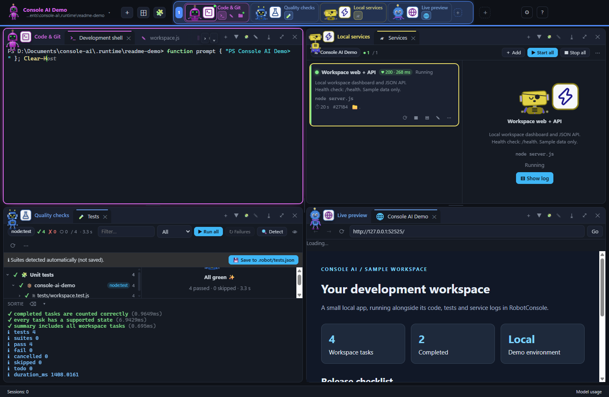

*Real screenshots of RobotConsole in English, using a fictional "Console AI Demo" project: a local Node.js app, sample tasks, Git changes and actual test runs. No external AI service or personal data is used.*

## Features

### Spaces, robots, screens
- **Spaces**: each area of the window groups tabs and carries a generated robot (name, colors, accessories). The robot animates when a terminal writes, flags unread tabs and can change its look depending on the active tab.
- **Free layout**: split the window into columns and rows, resize, maximize a space (`Ctrl+Shift+M`), drag tabs from one space to another.
- **Robot bar**: every space is visible at the top; you can "park" a robot to free up room while its terminals keep running, then bring it back with a click. Double-click a robot in the bar to put it to sleep: it shrinks and its tabs are summed up by a single badge, including unread/error indicators. Use the badge to choose a tab, or click the robot to wake it. A whole screen can be folded into small squares.
- **Drag-and-drop organization**: reorder tabs, send them to another robot or screen, or drop a tab into an empty part of the robot bar to create a new space.
- **Screens**: several sets of spaces in the same window, like virtual desktops (`Ctrl+Alt+1…9`, `Ctrl+Shift+Alt+←/→`).
- **Multiple windows**: a space can be detached into another window, then brought back by drag and drop.
- **Workspace switcher**: the top-left workspace menu lists open workspaces and their secondary windows. Select one to focus its existing window, restoring it if minimized; the current window is marked.
- **Session restore**: layout, tabs and terminals come back after a restart (terminals run in a separate process and survive a reload).
- **Status bar**: manage persistent terminal sessions and check Copilot, Codex and Claude subscription quotas without opening a tool tab.

### Command palette

Press **Ctrl+Shift+Space** (**Cmd+Shift+Space** on macOS) to open a searchable command palette centered in your active tab. **Up/Down** select, **Enter** confirms, **Right** advances when the search cursor is at the end, **Left** returns when the search field is empty, and **Escape** closes. Press the shortcut again to close it. Ctrl+Space remains available for editor completion.

Choose an action, then its type or destination: open a tab, move the active tab to a zone or internal screen (including a new zone), find a file, or switch tabs, zones and screens. **Switch zone → New zone** creates and selects an empty zone in the current screen; **Switch screen → New screen** creates and selects an empty screen. Zones show their actual robot; tabs show their configured icon. Moving a tab keeps its live terminal or unsaved editor.

File search uses the current workspace by default. **Search another workspace** explicitly selects an open or recent workspace; the file opens in the original zone without switching workspaces. An editor tab already open in this window is reused. Git metadata, ignored files and dependencies are excluded by default; the checkbox includes ignored files and dependencies, but never `.git`. Search is asynchronous and bounded; partial results and errors are shown instead of silently reporting no matches. Search matches file names and paths, not file contents.

The palette closes if you change its source tab, zone or screen. Other zones stay accessible; blocking confirmations must be closed before opening it.

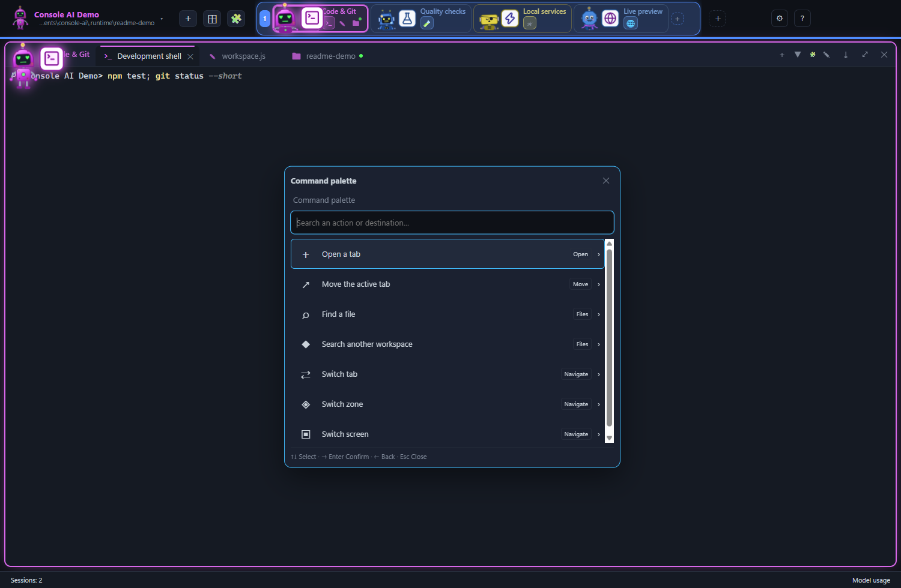

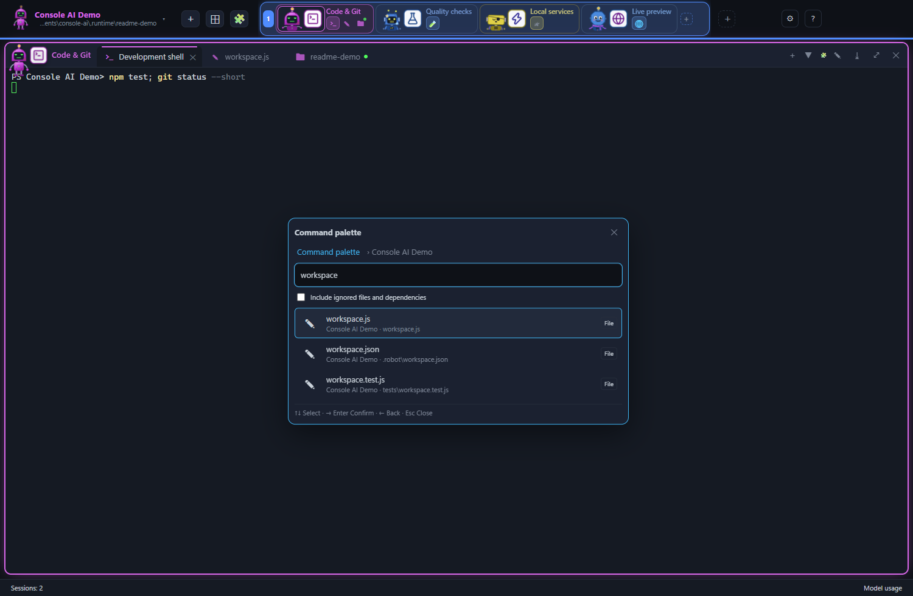

### Tab types

| Tab | What it does |
| --- | --- |
| **>_ Terminal** | xterm.js + node-pty: PowerShell 7, Windows PowerShell, cmd, Git Bash and WSL on Windows; your login shell, Bash, Zsh, Fish and sh on macOS/Linux. Search, clickable links, WebGL rendering, startup commands. |
| **📁 Explorer / editor** | File tree, code / Markdown / image previews, Git status and diffs, staging / discarding, favorites and file operations. Built-in Monaco editor with find / replace, multiple cursors, undo / redo, display options and a clickable status bar. |
| **🧪 Tests** | Discovers suites and groups them by category (unit, business rules, integration, end-to-end…). Supports Vitest, Jest, Playwright, node:test, pytest, Go, Cargo and custom commands. Run all suites or retry failures, inspect output, filter results and enable watch mode. |
| **🐳 Docker** | Containers grouped by compose file: status, health, ports, CPU, memory, actions and live logs. |
| **🛰 Services** | Workspace services (`.robot/services.json`): start / stop, detected ports, HTTP health checks, automatic restart, interactive logs. |
| **◆ Prisma / DB** | Prisma schema, table diagram, data browsing, SQL console (PostgreSQL), migrations. |
| **🕸 Graphify** | Builds and displays the project's knowledge graph with [Graphify](https://github.com/Graphify-Labs/graphify): interactive graph, report, log. |
| **🌐 Browser** | An isolated web browser, handy for keeping `http://localhost:3000` next to your terminal. |


### Files, Git and code editing
- Browse files, preview code, Markdown and images, inspect Git changes and stage or discard individual files. Create, rename, copy, move, duplicate or send files to the recycle bin.
- Open a file in Monaco with double-click or `Enter`. `Ctrl+F` / `Ctrl+H` in an editable text preview opens the editor with find / replace; those shortcuts and `Ctrl+G` also work from the editor's surrounding controls.
- Use rectangular selection, multiple cursors, line operations, comments, word wrap, minimap, sticky scroll and zoom. The status bar exposes line/column, indentation, encoding, line endings and language.
- Undo / redo is retained when a file is closed and reopened within the same app session. External changes reload clean files; unsaved edits trigger a warning with a choice to reload from disk or keep your version. The editor also warns if a file disappears, and its path can be changed to open another file.


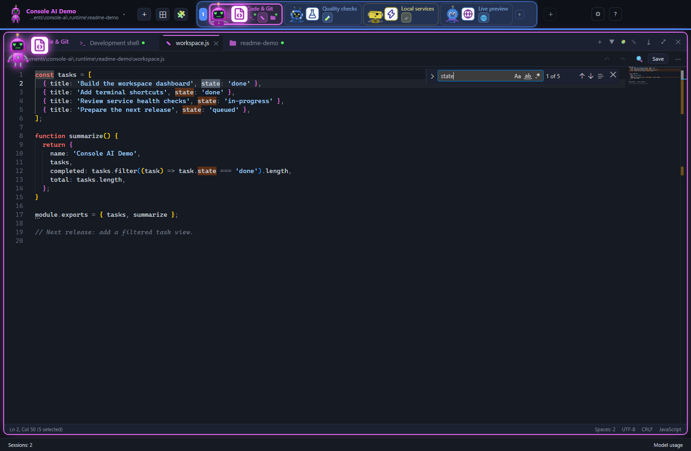

### Prompt editor for Claude, Codex and Copilot CLI
Click **✎** in a terminal space header, use `Ctrl+Shift+P` (`Cmd+Shift+P` on macOS), or choose **Write a prompt…** in the terminal context menu.

- The editor is a panel inside its terminal tab, not a window-wide modal. Other zones and tabs remain accessible; each tab keeps its own editor and draft. Confirmations stay inside that panel and are canceled when the editor closes.
- Draft and edit multiline text with native French/English spellchecking and right-click suggestions. Dictionaries may need an initial download; prompt text is not sent to a spelling service.
- Type `/` **in the editor** for `/fichier` (documents), `/selection` (terminal selection), `/dossier` (starting directory), `/brouillons`, `/historique`, `/favoris` and `/favori` (save a favorite). CLI slash commands typed in the terminal are unchanged.
- Select documents or files already open in the editor. **Path only** adds the exact path to the prompt for the CLI to read; **Text content** includes a text file up to 32 KB. These are prompt references, not provider-specific uploads. **Preview** shows the resulting text.
- Paths use the host operating system. If your CLI runs inside WSL or a container, adapt the path or use **Text content**.
- **Send to terminal** (`Ctrl+Enter` / `Cmd+Enter`) pastes and presses Enter. **Insert without sending** only pastes. Use an empty, ready CLI input: this tool does not clear existing input or interrupt a running response. Multiline pastes require confirmation if the terminal has not enabled bracketed paste.
- Drafts autosave after 400 ms of inactivity and when the editor or window closes. **New draft** keeps the previous draft; **Drafts** lets you find, resume or delete them, including after a restart. Up to 200 drafts are stored locally with their document references.
- History retains the last 100 distinct prompts and can be filtered by workspace or cleared. Save, reuse or delete up to 200 named favorites. Drafts, history and favorites are stored in the app's local `prompts.json`, outside the workspace; avoid saving secrets.
- Open **Settings → Prompt AI** (or **Configure in settings** in the prompt editor) to choose **Claude CLI** (existing login, automatic detection or absolute executable path) or **Anthropic API** (API key and model ID). The same configuration is also available under **AI assistant** in the editor. Save your rewriting instructions and configuration, then click **Improve with AI**. Only the prompt text is sent, after confirmation; document contents are not sent. The proposal must be applied explicitly, and the original is kept as a draft. No terminal submission or file access is performed by the assistant. Usage may consume subscription quota or API credits.
- API keys are encrypted using the operating system's secure storage and saved outside the workspace, never in ordinary settings or the renderer. If secure storage is unavailable, use Claude CLI. For Claude CLI, sign in with `claude auth login` first; a recent Claude Code version supporting print mode, tool restriction and session-persistence flags is required.

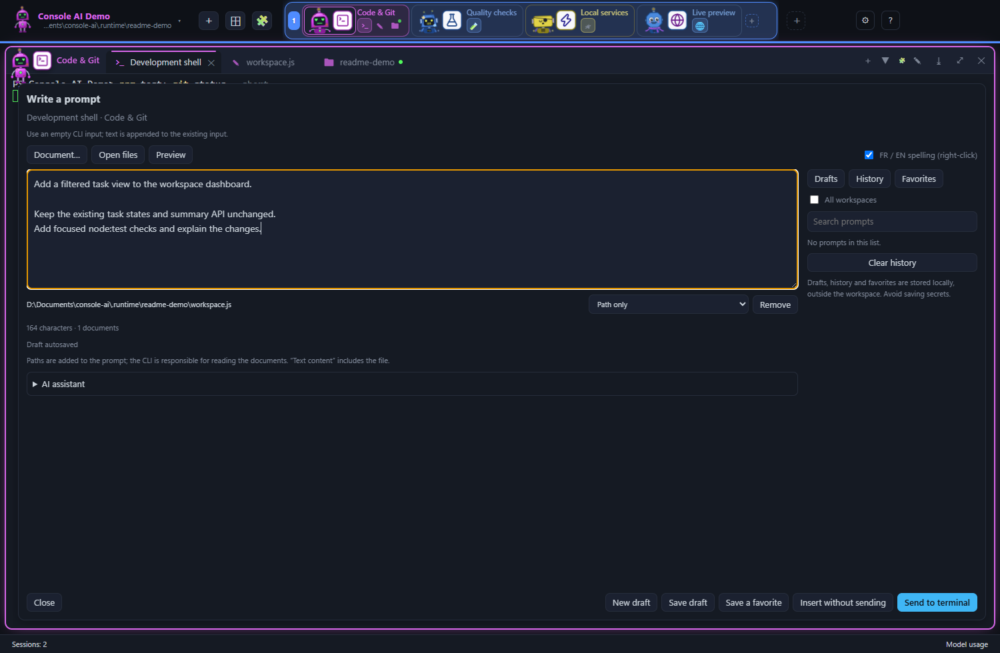

### Tests, services and live preview
Keep checks and runtime tools next to the code rather than switching between unrelated windows.

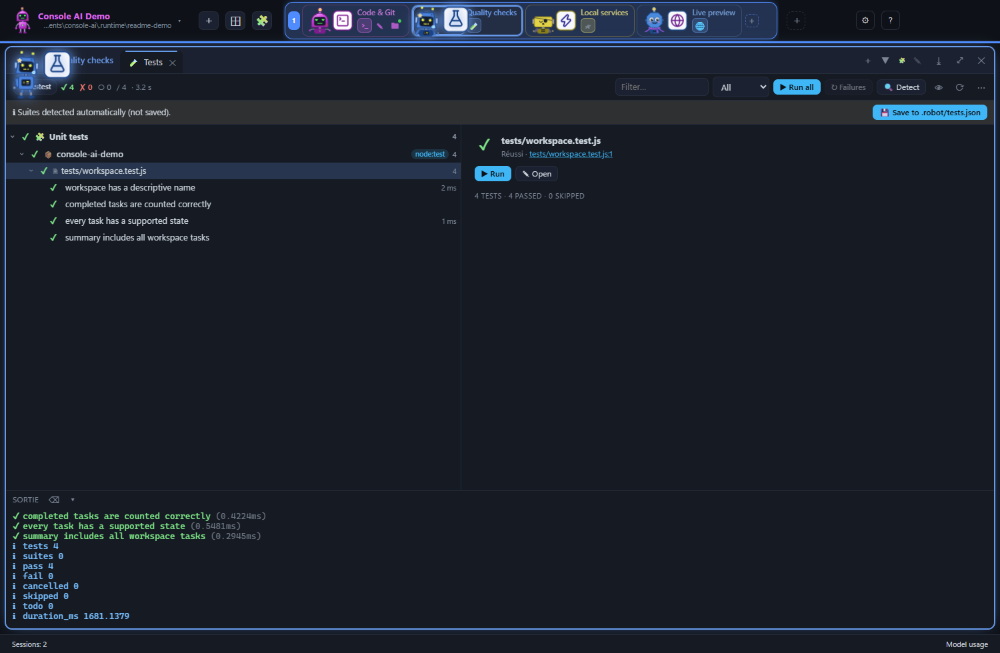

Workspace services show their status, detected ports and HTTP health checks, with start / stop / restart actions and interactive logs. The optional `description` from `.robot/services.json` is displayed with line breaks, including in the mobile view, and can be edited in the service form. Copy selected text with `Ctrl+C` / `Ctrl+Shift+C` or the context menu in the test, Docker and service consoles; interactive consoles also support paste.


The browser tab keeps a local web app inside your workspace, with its own address bar and navigation controls.


### Workspaces and templates
- **Workspace**: open a folder as a workspace (`Ctrl+O`). Its configuration lives in `.robot/` (name, robot, templates, favorites, services) and can be committed to share it with your team. The local layout stays in `.robot/state.json`, which Git ignores.
- **Templates** for tabs, zones and screens: save "a terminal in `apps/api` that runs `npm run dev`", a complete space or a whole screen, then reopen it in one click.

For example, keep a development screen with the editor and terminal, a quality-check screen with tests, and an operations screen with services, Docker or a database. Templates let you reuse the setup without rebuilding the layout.

### Remote access (phone, tablet)
- Open some robots to another device: click a robot → **📡 Sharing** → *Read-only* or *Control*. The panel shows a QR code that opens that robot directly on the phone (with the robot as the tab icon). The 📡 badge shows which robots are open. The end-of-work sound is set in the same panel (🔔).
- Enable the server in **Settings → Remote access** and scan the QR code with your phone (same Wi-Fi, or through a VPN such as Tailscale). Only open robots are visible.
- Terminals are live (with a key bar for Esc, Tab, Ctrl, arrows in control mode). The other tabs have a mobile view: start/stop services, run tests, Docker up/stop/restart, browse files and Git diffs, browse database tables, take a screenshot of a browser tab…
- The link carries a secret token (kept in a cookie, regenerable). Do not expose the port to the Internet.
- **From any network**: link the PC to a separately deployed, self-hosted [robotconsole-relay](https://github.com/simonbonjean-bot/robotconsole-relay) (Settings → Remote access → Relay → Sign in). Phones sign in to the same account; everything is end-to-end encrypted and each new phone is approved on the PC with a 6-digit code. See the [relay repository for setup instructions](https://github.com/simonbonjean-bot/robotconsole-relay).

#### On a smartphone
Choose an open robot from the workspace list, then switch between its shared tabs. A green indicator shows that the mobile page is connected. Control mode provides command input and a terminal key bar; read-only mode lets you follow output without sending commands.

| Open robots | Terminal in control mode | Terminal in read-only mode |
| --- | --- | --- |
| 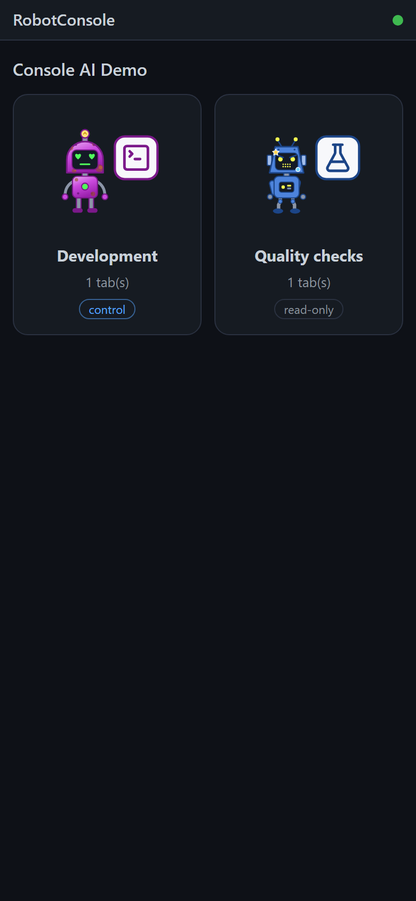 | 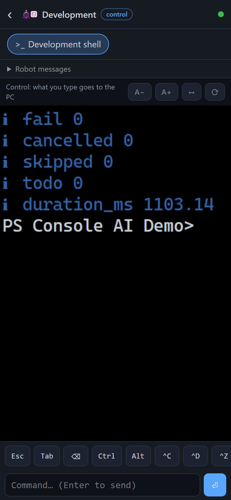 | 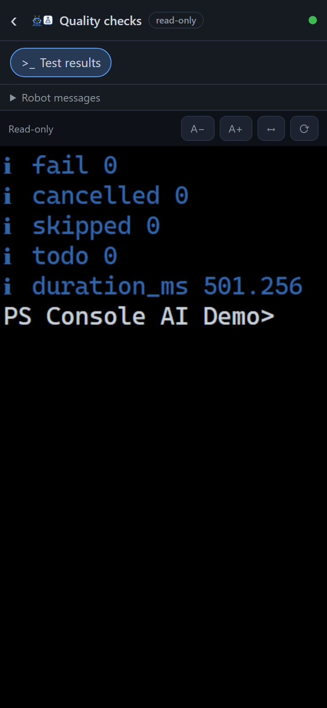 |

*Captured from the real mobile interface in Chrome's smartphone emulation (390 × 844 CSS pixels), connected over authenticated local HTTP/WebSocket to disposable demo terminals. These are not photographs of a physical phone or a demonstration of an Internet relay connection. No access token or QR code is shown.*

### Customization
- Themes: Midnight, Dawn (light), Ocean, Forest, Neon and High contrast. Each theme also sets the terminal palette and syntax highlighting.
- Robot workshop: look, colors, accessories, body parts (arms, locomotion, gear…) and tool icon of each robot. Each trait can be animated or not.
- **Robot bar styles**: Classic, Compact, Dock, Labels and Minimal, with previews in Settings. Choose between visible tabs, larger robots, space names or a slimmer bar.
- **Activity animations**: choose hammer taps, bounce, shake, pulse, swing or no animation for the "Working on" icon. It moves only while the space has activity; the tool can automatically match the current tab.
- Show or hide the robot's body in the space header, toggle animations and speech bubbles, and adjust completion-sound volume.
- Font, size, default shell, editor behavior, start screen…
- **Language**: English or French (Settings → Appearance → Language), or automatic based on the system language. The change applies immediately.

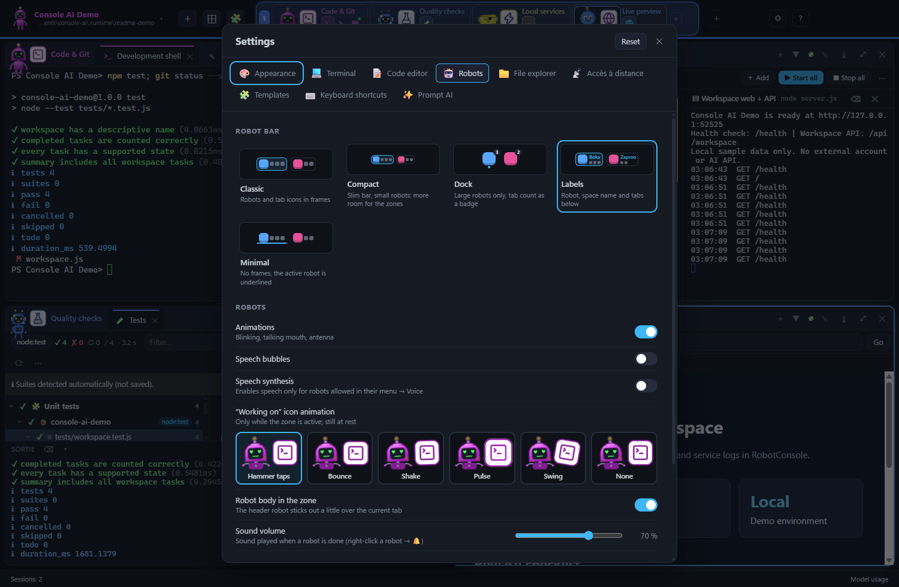

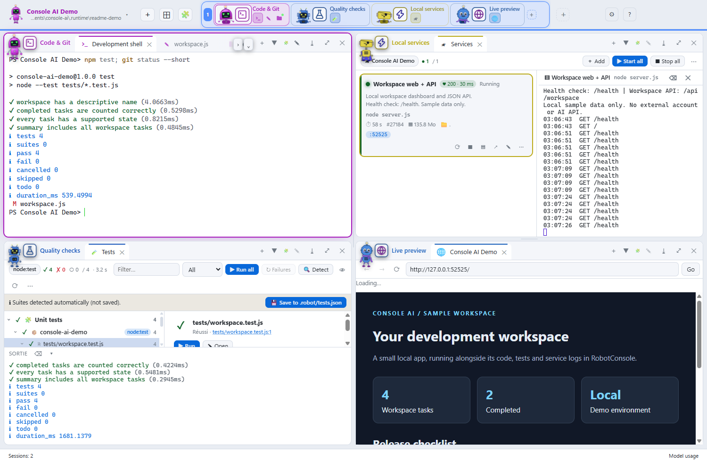

### Robot messages from the command line

`robot-say` sends a text message to a robot in the running RobotConsole application. The robot displays a bubble, saves the message in its history, and optionally reads it aloud. It works directly from a terminal or through the [progress skill](#progress-skill-for-claude-code-codex-and-copilot-cli).

#### Quick start

After installing RobotConsole's dependencies, start or restart the app and open a **new integrated terminal**:

```powershell
robot-say "C'est terminé"
```

The integrated terminal already has the command on PATH. No skill installation is needed to send a message manually. Node.js must be available in the terminal.

To use the command from **external terminals**, run this once from the RobotConsole checkout:

```powershell
npm link
```

This creates npm command launchers for `robot-say`. Your user's npm global prefix must be on PATH; `npm config get prefix` shows its location. Open a new terminal after changing PATH. The link points to this checkout, so keep the checkout in place or run `npm link` again after moving it.

If you do not want to install a global command, use the script's absolute path instead:

```powershell
node "D:\Documents\console-ai\bin\robot-say.js" "C'est terminé"
```

Replace that example path with your actual checkout location.

#### Command reference

| Command | Result |
| --- | --- |
| `robot-say "Message"` | Send a message from an integrated terminal; outside RobotConsole, do nothing. |
| `robot-say --robot <id-or-name> "Message"` | Send a message to an explicit robot. Prefer an ID if names are duplicated. |
| `robot-say --list` | List open robots as an ID and name, separated by a tab. |
| `robot-say --history` | Print the detected robot's last 200 messages, oldest to newest within that selection. |
| `robot-say --history --robot <id-or-name>` | Print a specific robot's last 200 messages. |
| `robot-say --help` or `robot-say -h` | Display command usage without needing a running app. |
| `robot-say -- "--message"` | Send text beginning with `--` without interpreting it as an option. |

Messages must contain non-whitespace text and be at most **4,000 characters**. Quote the message as one argument and use the escaping rules of your shell. In PowerShell, literal single-quoted strings avoid variable expansion; double an apostrophe inside them:

```powershell
robot-say 'C''est terminé : les vérifications sont passées.'
robot-say --list
robot-say --robot "robot-id-from-the-list" "Je commence les vérifications."
robot-say --history
robot-say --history --robot "robot-id-from-the-list"
```

Successful sends produce no terminal output and return exit code **0** after the message has been saved. Outside an integrated terminal, a message without `--robot` intentionally does nothing and returns **0**, even if the app is closed. Invalid arguments and failures of integrated or explicit operations (unavailable app, ambiguous target or persistence failure) produce an error on stderr and exit code **1**. A successful send does not mean that optional audio playback has finished.

Messages appear temporarily as floating speech bubbles below the robot in the robot bar, outside its tile, and below the originating terminal's tab in its zone, even when another tab is active. Application messages appear below the active tab (or the tab strip in an empty zone). The bubbles do not resize the robot bar and follow the robot when its screen is folded. They disappear automatically; clicking either display dismisses both without deleting the saved message. Long messages wrap and can be scrolled inside the bubble.

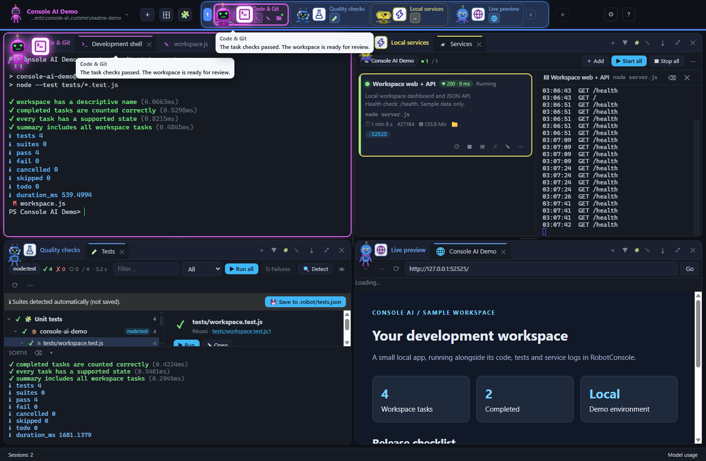

#### Automatic robot / zone detection

Target selection follows this order:

1. **Explicit `--robot`**: match the robot's ID or exact name.
2. **Integrated terminal**: use the originating terminal session and find the robot that currently contains its tab. Moving the tab to another zone or window changes the target automatically. A closed or missing session is not silently replaced by another robot.
3. **External terminal**: automatic messages are skipped. Use `--list` and an explicit `--robot` ID to send a message manually. For `--history` without `--robot`, the current directory must match exactly one robot's workspace / terminal folders.

RobotConsole must be open. Notifications use a local named pipe on Windows and a private Unix socket on macOS/Linux; remote sharing does not need to be enabled. Robots on another computer are not targets of this local command.

Integrated terminals pass these variables to child processes, including assistants:

| Variable | Purpose |
| --- | --- |
| `ROBOTCONSOLE_SESSION` | Identifies the originating terminal session. Preserve it to retain automatic robot detection. |
| `ROBOTCONSOLE_SPEECH_PIPE` | Selects the running app's local notification endpoint. Overrides endpoint discovery from the profile. |
| `ROBOTCONSOLE_USERDATA` | Selects the application profile, including its history and settings. |

For an external terminal using a non-default profile, set `ROBOTCONSOLE_USERDATA` to the same directory used when starting the app:

```powershell
$env:ROBOTCONSOLE_USERDATA = "D:\RobotConsoleProfiles\work"
robot-say --list
```

Existing shells restored from before this feature need to be closed and reopened to inherit the command and variables. Windows-hosted WSL shells do not inherit a usable Windows Node command/socket; use a Windows terminal for notifications.

#### Message history and deletion

Click a robot to see **all its saved messages in the section on the right**, newest first. The list updates while the menu is open. Each message shows its date and source: `cli` for `robot-say` / assistant notifications, or `app` for messages generated by RobotConsole.

New messages also save the originating tab's title and emoji/icon. Click that label to reveal the tab, including after moving it to another robot. Closed or unavailable tabs keep their saved label but cannot be clicked; older messages without tab metadata remain unchanged.

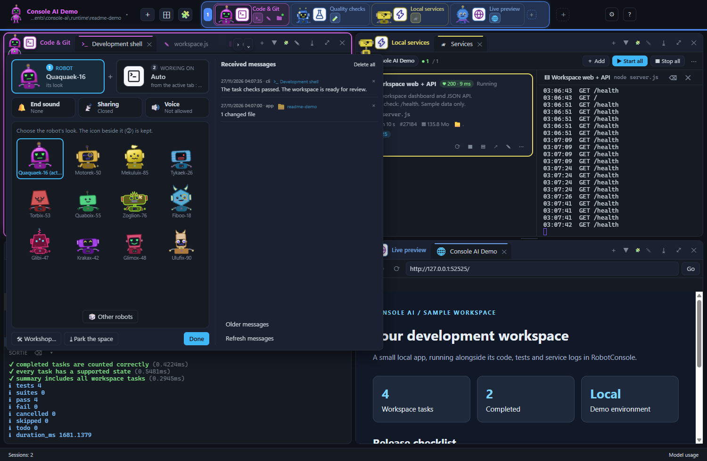

- Use the **×** button beside a message to delete just that message.
- Use **Delete all** (**Tout supprimer** in French) and confirm to permanently clear the selected robot's messages.
- Other robots' histories are not affected. Deletion is persistent and has no undo.
- The robot's context menu also opens a history dialog. `--history` reads recent messages in the terminal, but there is no CLI deletion option.

All robot messages are saved, including messages for hidden or parked robots and messages received with bubbles disabled. Incoming messages keep their original text rather than being translated. History persists across restarts in `speech-history.jsonl` in the app's profile: `%APPDATA%\RobotConsole` by default on Windows, or the directory selected with `ROBOTCONSOLE_USERDATA`.

The file is local to the profile, not committed to the workspace, and has no automatic retention limit. Do not send credentials, private file contents or other sensitive information: messages are visible in the interface and saved as plain text in the local history file.

#### Optional speech synthesis

Voice playback requires **both** the global setting and explicit permission for the individual robot. Both are **off by default**. Enable **Settings → Robots → Speech synthesis** (**Paramètres → Robots → Voix de synthèse** in French), then click the robot → **Voice** (**Voix**) → **Allow this robot to speak** (**Autoriser ce robot à parler**). Permission is saved per robot and follows it when moved between windows; new robots do not inherit it. Removing permission stops its current playback and cancels its queued voice messages. Disabling the global setting stops all robot speech without erasing individual permissions. This applies to both application messages and `robot-say` notifications; bubbles and history remain independent.

Windows uses **eSpeak NG** locally. Run `npm run install:espeak` once to download and extract the official Windows release into `.runtime/espeak` (no system installation). macOS uses the built-in `say`; Linux requires Speech Dispatcher (`spd-say`, for example `sudo apt install speech-dispatcher` on Debian/Ubuntu). On macOS/Linux, `npm run install:espeak` only checks the native speech tool; it does not install system packages. The app volume controls speech volume on all three platforms. Messages are read sequentially, with at most 20 pending requests. Voice errors are shown without discarding messages or history.

On Windows, click a robot → **Voice** → **Robot voice** to choose a French or English eSpeak NG robot voice. The default is French. The choice follows the robot between windows and does not grant speech permission. Old Windows voice selections switch to the French default. Voice selection is not currently supported on macOS/Linux.

Use **Refresh voices** to reload the list after installing eSpeak NG. The robotic timbres are bundled with eSpeak NG; no online service or neural voice model is used.

### Progress skill for Claude Code, Codex and Copilot CLI

The shared skill source is `skills\robot-say\SKILL.md`. It teaches an assistant to call the same local command to announce the start of work, meaningful milestones, questions, blockers, changes of approach and actual completion. Automatic notifications run only when both `ROBOTCONSOLE_SESSION` and `ROBOTCONSOLE_SPEECH_PIPE` are inherited from an integrated terminal; outside RobotConsole, the skill skips notifications and continues the task normally.

The installer also installs these project-aware skills for Claude Code, Codex and Copilot, using the same user-wide or workspace scope:

| Skill | Purpose |
| --- | --- |
| `robot-open` | Open a saved file in a RobotConsole editor tab, or activate its existing tab. |
| `robot-services` | Inspect the project and create or merge `.robot/services.json` using its real development commands. |
| `robot-tests` | Inspect test runners and create or merge `.robot/tests.json` with the project's actual suites. |

For example, ask your assistant: **« Crée un fichier todo.md et ouvre-le »**, **« Configure services.json pour ce projet »**, or **« Configure tests.json pour ce projet »**. Configuration skills preserve existing customizations and do not start services or tests automatically.

The `robot-open` command is available on PATH in integrated terminals and requires an inherited terminal session and a running RobotConsole. Relative paths use the terminal's current directory; it follows the terminal's robot even after moving the tab. It opens files in RobotConsole, not the operating system's default application:

```powershell
robot-open "todo.md"
robot-open "D:\Projects\my-app\.robot\tests.json"
```

The file must already exist. Restart RobotConsole after updating the app, and restart your assistant after installing the new skills. Shared sources live in `skills\<skill-name>\SKILL.md`; user-wide installation writes each skill under `%USERPROFILE%\.claude\skills` and `%USERPROFILE%\.agents\skills`.

**Installing the skill and installing the command are separate steps.** The skill installer copies instructions; it does not install Node.js, the assistant CLI, or the global `robot-say` command. An integrated RobotConsole terminal already supplies the command, while external terminals need `npm link` or the script's absolute path.

#### Install for your user or a project

**From the interface (no terminal command needed):** open **Settings → RobotConsole skills** (**Paramètres → Skills RobotConsole** in French). Click **Install for all my projects** for a user installation, **Install in this workspace** for the open workspace, or **Choose a folder…** to select another project. The section shows the user / workspace installation status and asks before replacing different, potentially customized copies. Each button installs all four skills for Claude Code and shared Codex / Copilot together. Restart the assistant afterwards.

Run the installer from the RobotConsole checkout. The recommended user installation makes the skill available across your projects:

```powershell
npm run install:robot-skill -- --user
```

To add only the three new skills while keeping a customized `robot-say` copy:

```powershell
npm run install:robot-skill -- --user --skill robot-open --skill robot-services --skill robot-tests
```

For this checkout only, or for another project:

```powershell
npm run install:robot-skill
npm run install:robot-skill -- --project "D:\Projects\my-app"
```

**From a terminal in another project**, do not run `npm run install:robot-skill` directly: npm looks for that script in the current project's `package.json`, where it normally does not exist. Instead, invoke RobotConsole's installer by its absolute path:

```powershell
# Install in the project where this terminal is currently located.
node "D:\Documents\console-ai\scripts\install-robot-skill.js"

# Or install for your user, across all projects.
node "D:\Documents\console-ai\scripts\install-robot-skill.js" --user
```

Replace `D:\Documents\console-ai` with your RobotConsole checkout location. The direct script only needs Node.js; it does not require adding an npm script or dependencies to the target project. On another machine, make the RobotConsole checkout (including the installer and shared skill source) available there first, then use its local path.

Alternatively, run npm against the RobotConsole checkout while explicitly keeping the destination as your current project:

```powershell
npm --prefix "D:\Documents\console-ai" run install:robot-skill -- --project "$PWD"
```

The `--project "$PWD"` argument matters here: `--prefix` runs the npm script from RobotConsole, not from your target project.

| Assistant | Project installation | User installation on Windows |
| --- | --- | --- |
| Claude Code | `.claude\skills\robot-say\SKILL.md` | `%USERPROFILE%\.claude\skills\robot-say\SKILL.md` |
| Codex CLI | `.agents\skills\robot-say\SKILL.md` | `%USERPROFILE%\.agents\skills\robot-say\SKILL.md` |
| Copilot CLI | `.agents\skills\robot-say\SKILL.md` | `%USERPROFILE%\.agents\skills\robot-say\SKILL.md` |

The same installation command writes both the Claude and shared Codex / Copilot copies. Restart the assistant after installation if the skill does not appear. These instructions concern the **terminal CLIs**, not the Claude desktop application's chat interface.

#### Activate in Claude Code

1. Start RobotConsole and open a **new integrated terminal** in the project you want to work on.
2. Run `claude` in that terminal.
3. Invoke `/robot-say`, or ask Claude to use the skill as part of your task:

```text
Utilise le skill robot-say pour m'informer de l'avancement pendant que tu corriges ce problème.
```

Keep RobotConsole open and allow the assistant to run the local notification command when prompted.

#### Activate in Codex or Copilot CLI

Use the same new-integrated-terminal workflow, starting `codex` or `copilot` instead of `claude`.

| Assistant | Skill invocation / discovery |
| --- | --- |
| Codex CLI | Mention `$robot-say` in the task, or use `/skills` to select it. |
| Copilot CLI | Invoke `/robot-say`; `/skills list` lists discovered skills and `/skills reload` reloads them. |

You can also use the natural-language request above with either assistant. The assistant still needs permission to execute local shell commands.

#### What the skill does — and does not do

The skill asks the assistant to use brief, factual messages in your language, with roughly no more than one routine update per minute. For example:

```powershell
robot-say "Je commence l'analyse du problème."
robot-say "La correction est prête, je vérifie son fonctionnement."
robot-say "Quelle base de données dois-je utiliser : PostgreSQL ou SQLite ?"
robot-say "Je suis bloqué : une dépendance nécessaire est indisponible."
robot-say "C'est terminé : la correction est en place."
```

It does not announce every tool call or claim completion before the work is actually complete. If notification fails, it instructs the assistant to report that failure once in the normal response and continue the engineering task, rather than retrying in a loop or claiming the robot received the message.

Whenever the assistant needs your input, it sends the **actual question and relevant choices** to the robot before asking through the CLI's normal question tool or prompt. This applies to clarifications, decisions and confirmations; questions are not subject to the routine-update frequency guideline. You still answer in the CLI: the robot notification does not collect answers or replace approval checks. If notification execution is not permitted or no robot can be selected, the assistant asks normally in the CLI without bypassing permissions.

The skill is **instructions, not an automatic background hook**. Installing it does not guarantee notifications in every conversation: activate it for the task. It does not report anything while the assistant is idle, install software without permission, or bypass execution restrictions.

#### Update or customize the skill

Edit `skills\robot-say\SKILL.md` to change the shared instructions, then rerun the installer for the desired scope. Identical existing copies can be reinstalled. A different existing copy is protected: the installer stops rather than overwriting it.

To explicitly replace your installed user copies with the shared source:

```powershell
npm run install:robot-skill -- --user --force
```

Use `--force` only if you intend to replace any customizations in those installed copies. For a project copy, combine it with `--project "D:\Projects\my-app"`. Restart the assistant, or reload Copilot's skills, after updating.

#### Troubleshooting

| Symptom | Action |
| --- | --- |
| npm reports `Missing script: "install:robot-skill"` | You ran the command in another project's folder. Invoke RobotConsole's installer by its absolute path, or use `npm --prefix` with an explicit `--project` destination as shown above. |
| `robot-say` is not found | Open a new integrated terminal, or run `npm link` from the checkout and verify the npm global prefix is on PATH. Alternatively invoke `node` with the absolute script path. |
| RobotConsole is closed / profile incorrect | Start the app. For a custom profile, match `ROBOTCONSOLE_USERDATA`; do not reuse a pipe variable from another profile. |
| No robot matches / several robots match | Run `robot-say --list` and pass an explicit `--robot` ID. In an integrated terminal, preserve the inherited session variables. |
| Notifications stopped after restoring an old shell | Close that terminal tab and open a new one to inherit the current command and environment. |
| The skill does not appear in Claude | Verify the user or project `.claude\skills\robot-say\SKILL.md` path, then restart Claude Code. |
| The skill does not appear in Codex / Copilot | Verify the relevant `.agents\skills\robot-say\SKILL.md` path and restart the CLI. In Copilot, use `/skills list` and `/skills reload`; also check that the skill is not disabled or its location ignored. |
| The installer refuses an existing skill | Keep your custom copy, or explicitly rerun with `--force` after deciding to replace it. |
| Bubbles appear but there is no sound | Enable global speech synthesis and allow that robot to speak in its menu → Voice. On Windows, run `npm run install:espeak` and check the volume setting. Review any voice error shown by the app. |
| The assistant cannot execute the command | Grant the appropriate local-command permission if permitted by your environment; the skill does not override sandbox or execution policies. |

For contributors, `npm run test:speech` covers command parsing and transport, history persistence and deletion, skill installation, and the Electron message interface / real IPC integration.

## Installation

Requirements: **Windows 10/11, macOS or desktop Linux**, [Node.js](https://nodejs.org) **24 LTS**, and Git. Install dependencies separately on each operating system and CPU architecture; do not copy `node_modules` between machines. Electron and node-pty use native platform binaries.

```bash
git clone https://github.com/simonbonjean-bot/RobotConsole.git
cd RobotConsole
npm ci
npm start
```

After installing dependencies, use `Lancer RobotConsole.bat` on Windows, `./Lancer\ RobotConsole.command` on macOS, or `./Lancer\ RobotConsole.sh` on Linux. `npm start` works on all three systems.

On Linux, Electron needs a graphical session (X11 or Wayland with XWayland) and the distribution's GTK 3, NSS, GBM and ALSA libraries. Debian/Ubuntu installations can use `sudo apt install libgtk-3-0 libnss3 libgbm1 libasound2t64` (older distributions call the last package `libasound2`). Do not run the app as root or disable Chromium's sandbox. If node-pty has no prebuilt binary for your machine, its installation also needs Python 3 and a C/C++ toolchain (`build-essential` on Debian/Ubuntu, Xcode Command Line Tools on macOS).

On macOS/Linux, RobotConsole discovers installed login shells and imports the login shell's PATH when started from a graphical launcher, so tools installed through Homebrew or a shell-managed Node installation remain available. On macOS, the native application menu supports Quit and editing shortcuts; closing the last window keeps the app available in the Dock.

Application data stays outside the checkout: `%APPDATA%\RobotConsole` on Windows, `~/Library/Application Support/RobotConsole` on macOS, and `${XDG_CONFIG_HOME:-~/.config}/RobotConsole` on Linux. `ROBOTCONSOLE_USERDATA` overrides this location. Unix IPC uses private, user-owned sockets and recovers sockets left behind after a crash.

Workspace paths, templates and file operations use native separators and preserve filename case on macOS/Linux. Commands saved in templates or `.robot/services.json` still need to work in the selected shell: RobotConsole does not translate PowerShell commands into Bash.

### Cross-platform checks

`npm test` runs unit tests, a real PTY shell/resize/reconnection check, and Electron UI tests. `npm run test:platform` runs only the platform and PTY checks. On headless Linux, run UI tests with `xvfb-run -a npm run test:ui`.

The GitHub Actions compatibility workflow runs on Windows, macOS and Ubuntu. Linux service port discovery requires `ss` (the `iproute2` package) or `lsof`; macOS uses `lsof`. Missing probing tools are reported in the Services tab rather than presenting empty results as successful detection.

For contributors, `npm run test:unit` includes prompt persistence, AI rewriting configuration, command-palette helpers and workspace file search. `npm run test:ui` exercises the real Electron prompt panels, keyboard navigation, file opening and tab moves.

`npm run test:perf` covers bounded file/database reads, terminal flow control, history, state persistence and deferred restoration. `npm run test:perf:terminal` measures terminal responsiveness. `npm run profile:perf` compares an isolated demo workload against an earlier commit; see [the recorded profile](docs/performance-profile.json) and [performance notes](TODO-PERF.md) for the measured scope and limitations.

### Optional tool requirements
The core terminal, explorer/editor and browser do not require Docker or a database. Tests use the selected project's own runner; services use the commands configured in `.robot/services.json`.

- **Docker tab**: Docker CLI and a running Docker engine; Compose projects use Docker Compose.
- **Prisma / DB tab**: a project's Prisma schema for the diagram, and a reachable PostgreSQL database for queries and data browsing.
- **Remote access**: enable the local server explicitly; access from other networks requires your own relay deployment or an appropriate private network.

### AI subscription connectors

Click **Model usage** in the bottom status bar for account quotas, reset times and connector settings. This replaces the AI subscriptions tab; old saved usage tabs are no longer restored. It is independent of the workspace, reads account quotas rather than API token costs, and makes no model inference calls. The compact summary shows each provider's highest reported quota consumption. Refresh manually or let the status bar refresh every five minutes while the window is visible. Missing data is not displayed as zero; unlimited quotas do not show a percentage.

Click **Sessions** in the same bar to list all RobotConsole PTY sessions, including other workspaces and services. The panel shows PID, start time, duration, directory or scope, and whether a session is linked to this window, another window or running in the background. **Show** reveals a local terminal; **Stop** requires confirmation and affects its shell and running programs. Ended sessions can be removed to release their retained history. Stopping a managed service also suppresses its pending automatic restart. Closing or restarting the app still preserves sessions.

- **Copilot** uses the bundled official Microsoft Copilot SDK runtime and its existing local authentication (`account.getQuota`). Sign in with Copilot first.
- **Codex** requires Codex CLI on PATH, signed in with a ChatGPT account (`codex login`). The connector starts a short-lived `codex app-server`, calls `account/rateLimits/read`, then stops it.
- **Claude** uses the documented Claude Code `statusLine` data, not private OAuth endpoints. Click **Enable Claude connector**, confirm, then use Claude Code. The installed Node.js script stores only quotas and the observation timestamp in RobotConsole's local data directory. A compatible Claude Code version and subscription session must expose `rate_limits`; otherwise the card reports unavailable. Old observations are marked stale, not reset to zero.

Claude activation adds a user-level `statusLine` setting, preserves other settings and backs up an existing settings file to `settings.json.robotconsole-backup`. It refuses to replace an existing status line: use **Copy connector command** to have your current script pass the same stdin JSON to the connector. Project-level status-line overrides must also call the connector. To disable it, remove only the added `statusLine` setting, or remove the connector call from your own script.

Contributor checks: `npm run test:subscriptions`. To check the locally signed-in Copilot and Codex accounts under Electron without printing quota values, run `node scripts/test-subscriptions-ui.js --live`.

### Graphify (optional)
The Graphify tab uses the `graphify` Python CLI (Python 3.11+):

```bash
uv tool install graphifyy     # or: pipx install graphifyy
```

The **Build** button runs `graphify extract . --code-only`, which analyzes the code locally, with no model or API key. The result is written to `graphify-out/` (`graph.html`, `graph.json`, `GRAPH_REPORT.md`), and the tab refreshes on its own when that folder changes.

## Keyboard shortcuts

Settings are organized into tabs: appearance, terminal, editor, robots, explorer, remote access, templates and keyboard shortcuts. In **Settings → Keyboard shortcuts**, click a binding and press a new combination; Escape cancels recording. Conflicts are reported before saving. Disable or restore individual actions, or reset all shortcuts. Changes are saved in the application profile and shared between its windows. Local terminal/editor shortcuts remain managed by their tools; application shortcuts take priority in the active tab.

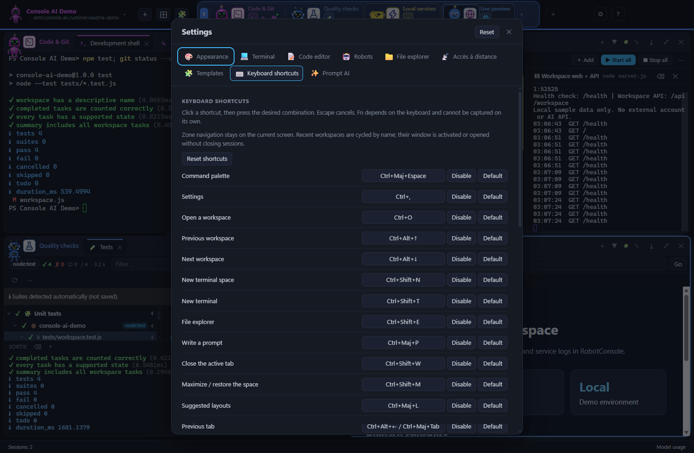

Fn is usually handled by the keyboard firmware and cannot be captured as an application modifier. The shortcuts below use Ctrl, Alt and Shift instead.

On macOS, Command is also accepted for default application shortcuts, copy/paste, search and save; terminal Ctrl+C remains available to interrupt processes. Ctrl+Tab still switches tabs. Hold Option while dragging files to copy on macOS (Ctrl on Windows/Linux).

| Shortcut | Action |
| --- | --- |
| `Ctrl+Shift+N` | New space |
| `Ctrl+Shift+T` | New terminal in the active space |
| `Ctrl+Shift+E` | File explorer |
| `Ctrl+Shift+W` | Close the tab |
| `Ctrl+Shift+M` | Maximize / restore the space |
| `Ctrl+Shift+L` | Choose a layout |
| `Ctrl+Shift+Space` | Open / close the command palette |
| `Ctrl+Shift+P` (terminal) | Open the prompt editor |
| `Ctrl+Enter` (prompt editor) | Send the prompt to its terminal |
| `Ctrl+Tab` / `Ctrl+Shift+Tab` | Next / previous tab |
| `Ctrl+Alt+←/→` | Previous / next tab in the current zone |
| `Ctrl+Shift+←/→`, `Alt+←/→`, `Alt+1…9` | Go to a visible zone on the current screen |
| `Ctrl+Alt+1…9`, `Ctrl+Shift+Alt+←/→` | Switch screen |
| `Ctrl+Alt+↑/↓` | Previous / next recent workspace by name; focus its existing window or open it without closing sessions |
| `Ctrl+O` | Open a workspace |
| `Ctrl+,` | Settings |
| `Shift+Enter` (terminal) | New line without submitting (Claude Code and other interactive CLIs) |
| `Ctrl+F` / `Ctrl+H` (editor or editable preview) | Find / replace |
| `Ctrl+G` (editor) | Go to line |
| `Ctrl+S` (editor) | Save |
| `Ctrl+Z` / `Ctrl+Y` (editor) | Undo / redo |

## Project structure

```
main.js            Electron main process (windows, IPC)
preload.js         API exposed to the interface (contextIsolation)
main/              terminals (ptyhost), files and Git, file search, prompt storage / AI rewriting,
                   tests, Docker, services, Prisma, Graphify, workspaces, i18n, remote access
renderer/          interface: app.js (spaces, layout, robots) and one file per tab type
                   command-palette.js + prompt-editor.js: navigation and terminal prompt panels
                   i18n.js + i18n-en.js: interface translation (French → English dictionary)
                   remote/: mobile page served by the remote access server
shared/            platform-neutral prompt and command-palette helpers
scripts/           tests, performance profiling, icon and emoji generation
docs/screenshots/  real desktop and mobile demo captures used in this README
build/             application icons
```

The app's data (state, settings) lives in the platform-specific application data directory described under [Installation](#installation). To run an instance with a separate profile, set the `ROBOTCONSOLE_USERDATA` environment variable.

### Translations
The interface source text is French. `renderer/i18n.js` translates what is displayed (texts, tooltips, placeholders) using the dictionary in `renderer/i18n-en.js`, where each French text maps to its English translation and `{0}`, `{1}`… mark variable parts. User content (terminals, editor, file previews, SQL data, logs) is never translated. To translate a new text, add its French version and translation to `i18n-en.js`; in code that writes outside the DOM (terminal messages, native dialogs), use `I18n.t('Texte {0}', value)`.
